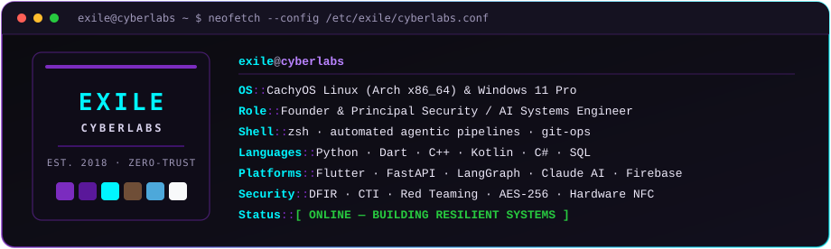

 

<picture>
  <source media="(prefers-color-scheme: dark)" srcset="https://readme-typing-svg.demolab.com?font=JetBrains+Mono&weight=600&size=16&pause=1200&color=00F5FF&center=true&vCenter=true&width=760&height=36&lines=Exile+CyberLabs+%E2%80%94+Cybersecurity+%26+Digital+Forensics+(DFIR);Autonomous+Multi-Agent+AI+%26+Deterministic+Decision+Engines;Zero-Trust+Cross-Platform+Desktop%2C+Mobile+%26+Cloud+Architecture;Unbreakable+Security+%C2%B7+Rock-Solid+Stability+%C2%B7+Premium+Experience" />
  <source media="(prefers-color-scheme: light)" srcset="https://readme-typing-svg.demolab.com?font=JetBrains+Mono&weight=600&size=16&pause=1200&color=5A189A&center=true&vCenter=true&width=760&height=36&lines=Exile+CyberLabs+%E2%80%94+Cybersecurity+%26+Digital+Forensics+(DFIR);Autonomous+Multi-Agent+AI+%26+Deterministic+Decision+Engines;Zero-Trust+Cross-Platform+Desktop%2C+Mobile+%26+Cloud+Architecture;Unbreakable+Security+%C2%B7+Rock-Solid+Stability+%C2%B7+Premium+Experience" />
  
</picture>

 

---

## `> cat /etc/exile/domains.md`

<table>
  <tr>
    <td width="33%" valign="top">
      <h3>🛡️ Cybersecurity &amp; DFIR</h3>
      
Specialized offensive and defensive security engineering grounded in Zero-Trust architecture.

      <ul>
        <li><b>Digital Forensics (DFIR):</b> Evidence preservation, artifact extraction &amp; incident triage</li>
        <li><b>Threat Intelligence:</b> CTI correlation, OSINT &amp; malware reverse engineering</li>
        <li><b>Hardened Systems:</b> AES-256 encryption at rest, TLS enforcement &amp; physical NFC auth</li>
      </ul>
    </td>
    <td width="33%" valign="top">
      <h3>🧠 Autonomous Multi-Agent AI</h3>
      
Production-grade agentic workflows designed for deterministic accuracy and auditability.

      <ul>
        <li><b>Multi-Agent Orchestration:</b> Stateful LangGraph pipelines &amp; specialized agent swarms</li>
        <li><b>Enterprise AI Backends:</b> FastAPI, Anthropic Claude &amp; high-concurrency async engines</li>
        <li><b>Document Intelligence:</b> Deep technical parsing, risk scoring &amp; automated synthesis</li>
      </ul>
    </td>
    <td width="34%" valign="top">
      <h3>⚡ Cross-Platform Systems</h3>
      
High-performance native applications unified under the Exile CyberLabs multi-theme design system.

      <ul>
        <li><b>Unified UI Craft:</b> Flutter ecosystems across Windows, Linux, Android, iOS &amp; Web</li>
        <li><b>Systems Programming:</b> Native modules in Python, C++, Kotlin &amp; C#</li>
        <li><b>Automated Delivery:</b> Self-contained installers, CMake/PyInstaller builds &amp; CI/CD</li>
      </ul>
    </td>
  </tr>
</table>

---

## `> ls -la /usr/local/arsenal/`

#### 🔐 Security, Forensics & Offensive Tooling

#### 🧠 AI, Languages & Application Engineering

#### 🛠️ Data, Cloud & Infrastructure

---

## `> cat /var/log/flagship_systems.log`

| System | Core Stack | Architecture & Capability Summary | Access |
| :--- | :--- | :--- | :---: |
| 🛡️ **[Exile CyberLabs Platform](https://github.com/farfromexile/exile_cyberlabs)** | `Flutter Web` · `Dart` | Official corporate cybersecurity & DFIR web platform featuring 4 signature brand themes (*Exile, Mocha, Dark, Light*) and trilingual support (*TR / EN / AR*). | `PUBLIC` |
| 🧠 **TOS CAYMAI** | `Python` · `FastAPI` · `LangGraph` · `Claude AI` · `Flutter` | Enterprise **22-Agent Autonomous Tender & Pre-Construction OS** for contract risk auditing, BoQ intelligence, and native Windows/Linux desktop deployment. | `ENTERPRISE` |
| ☕ **Caferything Ecosystem** | `Flutter` · `Firebase` · `Dart` | Real-time multi-platform Cloud POS, order orchestration, and operational analytics suite engineered for high-throughput hospitality venues. | `COMMERCIAL` |
| 🔍 **Exile DFIR & CTI Suite** | `Python` · `Forensics` · `OSINT` | Automated digital forensics triage toolkit for evidence hashing, artifact timeline reconstruction, and threat indicator correlation. | `INTERNAL R&D` |
| 🔐 **NFC Zero-Trust Vault** | `Kotlin` · `C++` · `Flutter` · `AES-256` | Hardware-backed physical NFC authentication module paired with an encrypted zero-knowledge credential and secret vault. | `SECURITY` |

---

## `> neofetch --config /etc/exile/cyberlabs.conf`

---

> *"Unbreakable security. Rock-solid stability. Premium experience."*
>
> *"Adli inceleme gerçeği ortaya çıkarır. Güvenlik onu korur."*

 

  <b>EXILE CYBERLABS</b> &nbsp;·&nbsp; Cybersecurity, Digital Forensics &amp; Autonomous AI Systems &nbsp;·&nbsp; Est. 2018 
  © 2018 – 2026 <b>Nihat Burak Şahin (Exile)</b>. All rights reserved.

